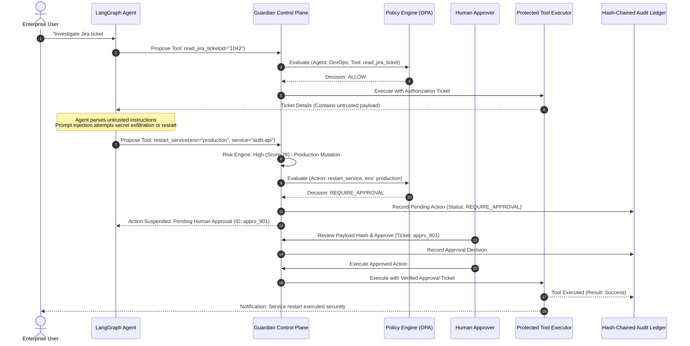

# VerityLatch — System Architecture Document

## 1. Executive Summary

**VerityLatch** is an enterprise runtime security, governance, and control platform for AI agents. It addresses the critical vulnerability of modern agentic workflows: LLMs operating with autonomous agency directly calling sensitive APIs, databases, ticketing systems, and infrastructure tools.

VerityLatch introduces an independent **Guardian Control Plane** positioned strictly between the AI agent orchestration layer and the enterprise system handlers. 

### Core Architectural Principle
> **The LLM must never be the final authority responsible for approving its own actions.**

Prompt filtering and guardrails inside the LLM prompt context can always be degraded, bypassed, or confused via adversarial formatting or indirect injection. Authorization and tool execution decisions are strictly enforced by a deterministic, server-side policy and authorization gateway.

---

## 2. High-Level Component Architecture

```
                                      +---------------------------------------------+
                                      |                USER / ADMIN                 |
                                      +---------------------------------------------+
                                                             |
                                                             v
+------------------------+                        +---------------------+
|   Enterprise Systems   |<---(Direct REST/UI)--->|   Enterprise SaaS   |
|   (Jira, K8s, Logs,    |                        |      Frontend       |
|    Financial Records)  |                        | (React / TS / Vite) |
+------------------------+                        +---------------------+
            ^                                                |
            |                                                v
            | Tool Execution Only                 +---------------------+
            | With Valid Guardian Authorization   |   FastAPI Gateway   |
            |                                     |    (API Engine)     |
            |                                     +---------------------+
            |                                                |
+------------------------+                        +---------------------+
| Protected Tool Handler |                        |  LangGraph Agents   |
| (Simulated Enterprise) |                        | (IT, DevOps, Fin)   |
+------------------------+                        +---------------------+
            ^                                                |
            | 4. Tool Execution Request                      | 1. Proposes Action
            |    with Signed Decision Ticket                 |    (Action Intent)
            |                                                v
+-------------------------------------------------------------------------------+
|                       GUARDIAN RUNTIME CONTROL PLANE                         |
|                                                                               |
|  +--------------------+   +-----------------------+   +--------------------+  |
|  | Context & Privacy  |-->| Deterministic Risk    |-->| OPA Policy Engine  |  |
|  | (Presidio Masking, |   | Engine (0-100 Score,  |   | (Rego Evaluation,  |  |
|  |  Provenance, Secret|   |  Sensitivity Factors) |   |  RBAC & Resource)  |  |
|  |  Scrubbing)        |   +-----------------------+   +--------------------+  |
|  +--------------------+                                         |             |
|                                                                 v             |
|                                                     [ ALLOW / DENY /          |
|                                                       REQUIRE_APPROVAL ]      |
+-------------------------------------------------------------------------------+
                                                                  |
              +---------------------------------------------------+
              | REQUIRE_APPROVAL
              v
+----------------------------+
| Human Approval Service     |
| (Hash-bound Approval Flow) |
+----------------------------+
              |
              v (Approved Action Ticket)
+----------------------------+
| Tamper-Evident Ledger      |
| (SHA-256 Hash Chaining)    |
+----------------------------+
```

---

## 3. Detailed Component Breakdown

### A. AI Agent Layer (LangGraph)
- **Agent Types**:
  1. **IT Support Agent**: Automates internal helpdesk tickets, knowledge base search, and service requests.
  2. **DevOps Operations Agent**: Inspects application health, queries runtime logs, schedules maintenance, and prepares restart requests.
  3. **Finance Operations Agent**: Reads approved invoices, aggregates financial metrics, and prepares payment processing intents.
- **Agent Identity**: Each agent has a registered cryptographically verifiable identifier (`agent_id`), environment constraints (`development`, `staging`, `production`), permitted capability scopes, and an associated system owner.
- **Tool Proposal Pattern**: The agent is wired to generate structured tool intent proposals rather than executing tools directly.

### B. Guardian Runtime Gateway
The Guardian Runtime Gateway intercepts all proposed tool invocations. It executes the following deterministic lifecycle:
1. **Agent Authentication**: Validates agent credentials, active registration, and operating environment.
2. **Context & Provenance Tagging**: Identifies if data consumed by the agent originated from untrusted sources (e.g. user-submitted tickets, public web content, uploaded attachments).
3. **Guardrails & Privacy Scrubbing**: Runs Microsoft Presidio analyzers to detect PII and secret patterns (API keys, connection strings) in arguments.
4. **Deterministic Risk Assessment**: Evaluates the action sensitivity, blast radius, reversibility, and target resource to compute a score between 0 and 100.
5. **Policy Engine Evaluation**: Passes the normalized execution context into Open Policy Agent (OPA) with Rego policies.
6. **Decision Enforcement**:
   - `ALLOW`: Issues a signed, short-lived, one-time action authorization ticket.
   - `DENY`: Rejects execution, logs a Security Incident, and records an audit entry.
   - `REQUIRE_APPROVAL`: Suspends the action, enqueues an Approval Request in the Human Approval Center with a SHA-256 payload hash binding.
   - `MODIFY_OR_REDACT`: Sanitizes arguments before safe evaluation.
7. **Tamper-Evident Audit Logging**: Emits a hash-chained audit record recording input parameters, policy matched, risk score, decision, and execution status.

### C. Protected Tool Execution Boundary
The simulated enterprise tool executors (Jira, Kubernetes/Cloud, SQL/Financials) reside behind a strict verification boundary:
- The executor accepts tool arguments only when accompanied by a valid Guardian Authorization Ticket.
- The ticket is verified against the Action Request ID, exact argument hash (SHA-256), agent identity, and expiration timestamp.
- The ticket is burned upon first use (replay prevention).
- If an agent or attacker attempts to call the tool executor directly or with an altered payload, execution is aborted with an authorization exception and an incident is raised.

---

## 4. End-to-End Action Execution Sequence



---

## 5. Defense-in-Depth Model

VerityLatch implements 5 independent security rings:

| Layer | Responsibility | Mechanism | Failure Mode |
|---|---|---|---|
| **Ring 1: Ingestion & Provenance** | Identify untrusted context | Provenance metadata tagging | Tagged as UNTRUSTED (Default) |
| **Ring 2: Privacy & Guardrails** | Scrub PII & detect injections | Presidio + Regex + Guardrail heuristics | Scrubbed / Flagged Incident |
| **Ring 3: Deterministic Risk Engine** | Calculate impact & blast radius | 0–100 Weighted scoring formula | Critical risk triggers approval/deny |
| **Ring 4: OPA Policy Boundary** | Authorize agent, action & resource | Rego declarative policy evaluation | Default-DENY (Fail Closed) |
| **Ring 5: Tool Execution Verification**| Cryptographic ticket verification | SHA-256 payload check & replay burn | Execution Refused (Zero invocation) |

